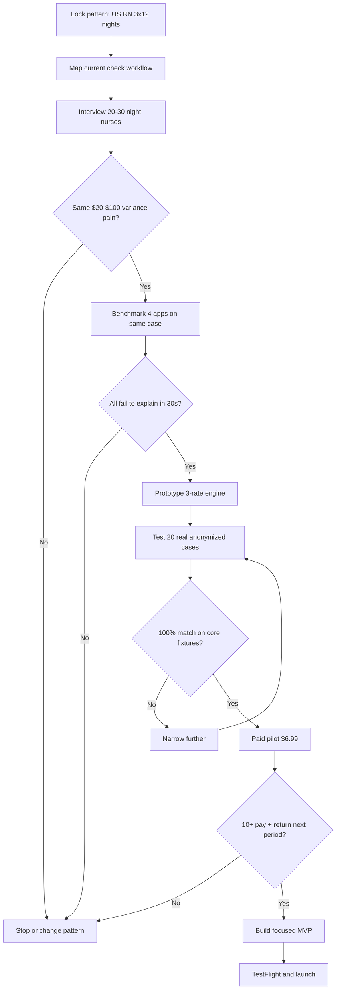
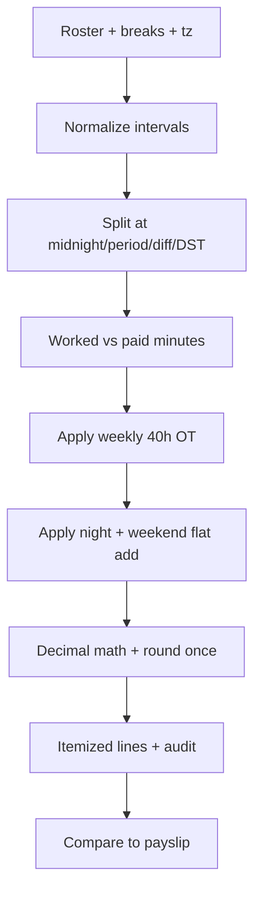
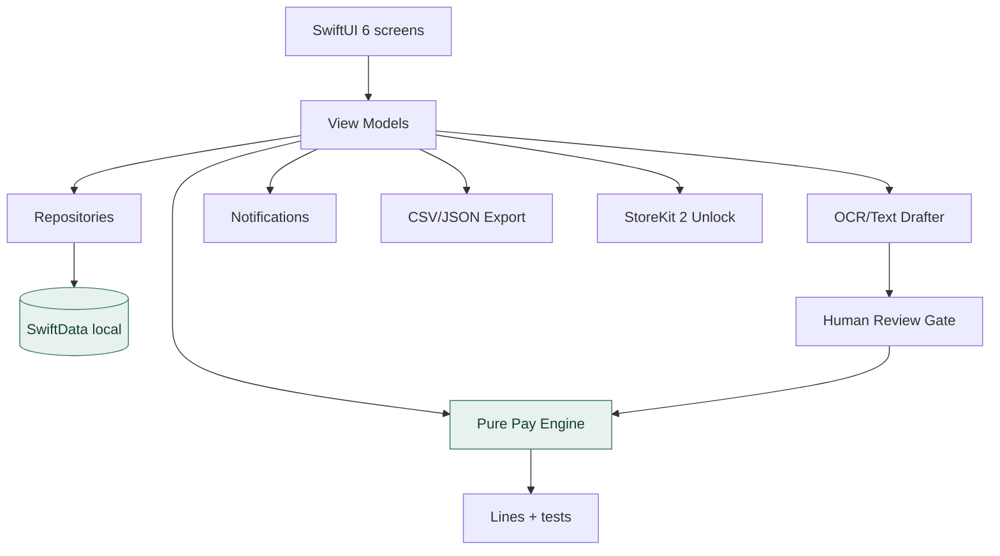
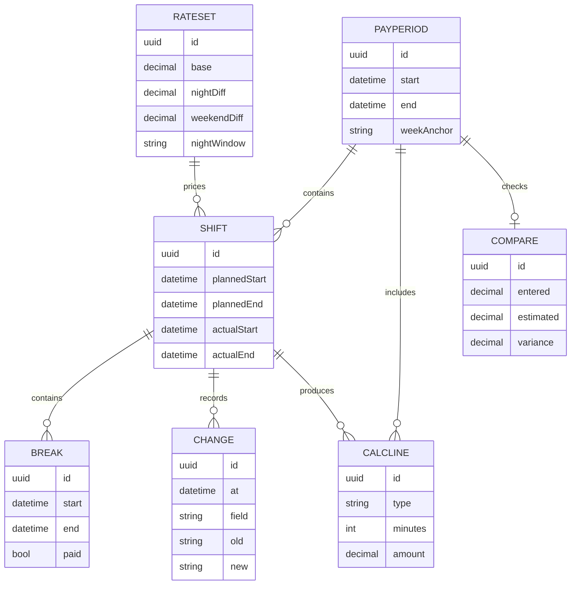
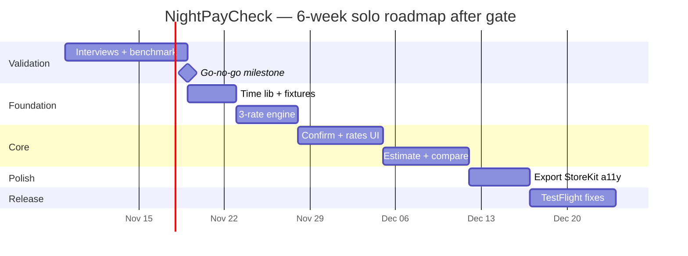
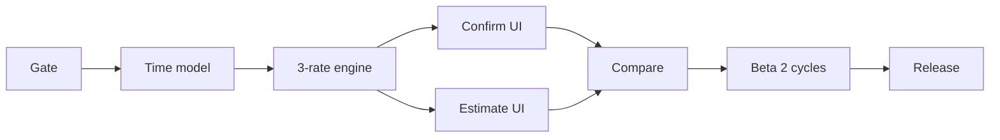
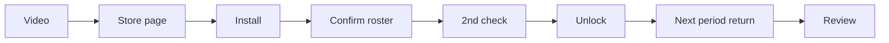
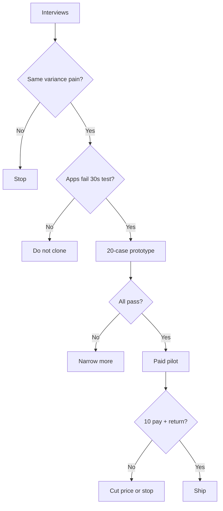

# NightPayCheck — Product Research & Development Blueprint

> **Version:** 1.0 · **Research date:** 6 November 2026 · **Status:** Discovery / pre-build · **Market:** US-first, English-only · **Platform:** iOS-first · **Business model:** Free checker + one-time unlock (to validate) · **Team:** Solo developer

## Executive decision

**Concept:** NightPayCheck is a private, offline-first **night shift pay checker for US hourly nurses**. Users paste or photograph a 2-week roster, confirm 3-6 shifts, set 3 rates (base + night diff + weekend diff), and get an itemized gross estimate to compare against a payslip.

It is deliberately **not** a calendar, not a team scheduler, not a time-clock, and not legal advice. Roster planning exists only to support the check.

**Critical research finding:** The general shift-calendar category is **crowded and review-driven** (Supershift, My Shift Planner, NurseGrid, ShiftWallet, HoursTracker). A solo dev cannot win on calendar breadth, widgets, sync, or community. The only defensible wedge is **explainable variance for one repeatable pattern**: `3x12 nights, 19:00-07:00, 30m unpaid meal, night + weekend differentials, 40h weekly OT`.

**Recommended initial segment:** US RNs / LPNs / CNAs working hourly 12-hour nights, paid biweekly, with separate night and weekend differentials. Validate only this pattern first.

**Decision:** Research first. Build a 1-week calculation prototype only if 12+ nurses describe the same unprompted payslip confusion and 8+ fail the same task in current tools.

---

## 1. Product thesis, boundaries and assumptions

### 1.1 Jobs to be done

1. **Check this paycheck:** "I worked three 12s, two were weekend nights — should this gross be $2,140 or $2,085?"
2. **Understand the gap:** "My payslip is $55 lower — is that the meal break, the weekend rule, or a missed differential?"
3. **Keep proof:** "Can I show what I actually worked vs what was scheduled?"
4. **Set up once:** "I don't want to re-enter my rates every pay period."

Non-job: planning next month's social life. That belongs to incumbents.

### 1.2 Explicit non-goals (MVP)

- Employer scheduling, unit staffing, swap boards, clock-in GPS, payroll processing.
- Automatic labor-law compliance, tax / net-pay guarantees, legal interpretation.
- Bank connections, HR integrations, accounts, backend sync, cross-user sharing.
- Generative AI as source of truth. OCR and Foundation Models may **draft** shifts; deterministic engine calculates.
- Multi-state rule library, holiday tables, per-diem / contract travel nursing logic.

### 1.3 Hypotheses to test

| ID | Hypothesis | Evidence required | Status |
|---|---|---|---|
| H1 | Night nurses regularly cannot reconcile gross due to diff stacking + meal break + OT interaction | 15+ interviews; repeated real examples with numbers | Unverified |
| H2 | Supershift / ShiftWallet / NurseGrid / spreadsheet cannot explain variance in <30 sec | Task-based comparison, 4 apps, same 3x12 case | Unverified |
| H3 | Nurses will pay $6.99-$9.99 once for a reliable offline checker | 10+ paid TestFlight / preorder commitments | Unverified |
| H4 | US night pattern is repeatable: 19:00-07:00, 30m unpaid, night diff $2-$6/hr, weekend diff $1-$4/hr, 40h OT | 20 anonymized pay stubs / rate sheets, same structure | Unverified |
| H5 | Roster → check completes in <3 minutes on first use | 10 observed usability sessions | Unverified |

### 1.4 North-star metric

**Pay periods checked with saved payslip comparison per month.** Supporting: roster-confirm completion, rate-setup completion, calculation trust rating, week-8 retention (biweekly cycle), paid conversion.

---

## 2. Research process — from market to go/no-go



### Phase A — desk research (2-3 days)

- ASO phrases: `night shift pay calculator`, `nurse shift planner`, `12 hour shift calculator`, `differential pay calculator`, `overtime tracker`, `payslip checker`, `nurse schedule app`.
- Collect **30+ reviews per app** for Supershift, My Shift Planner, NurseGrid, ShiftWallet. Prioritize 1-3 stars mentioning pay, differential, overtime, night, weekend, payslip. Record date, country, version, complaint, reproducible, fixed-in-update.
- Lurk r/nursing, r/CNA, allnurses, Facebook public pages; distinguish genuine complaint from promo. Do not scrape private groups or publish payslips.
- Price sheet by US storefront on one date. Paywalls change monthly.
- Screenshots for internal analysis only; do not copy UI, copy, icons.

### Phase B — user discovery (5-7 days)

**Recruit:** 20-30 US hourly night nurses (mix RN/LPN/CNA, med-surg, ICU, ED, LTC). Biweekly pay ideal. Consent before viewing any stub. Offer $10 coffee card for 20 min.

**Interview prompts:**

1. Walk me through your last paycheck — how did you know it was right?
2. Show me your roster — paper, app, text from manager?
3. Last time it looked off — what was the amount, what did you do?
4. What do you calculate by hand? Night diff? Weekend? OT?
5. Which app / spreadsheet tried? Why quit?
6. What proof would make you trust an estimate?
7. Would you pay once ($7) to check each paycheck in 1 minute? What would stop you?

**Do not ask:** "Wouldn't an AI nurse app be great?" Observe behavior.

### Phase C — competitor task benchmark (3 days)

Same case in each app: 3 shifts `Fri 19:00-07:00, Sat 19:00-07:00, Mon 19:00-07:00`, 30m unpaid each, base $38, night +$4.50 (19:00-07:00), weekend +$3.00 (Sat-Sun), weekly OT 40h @1.5x base. Pay week Mon-Sun.

Score: task success, taps, seconds, amount vs hand-calc, explanation quality 1-5, offline works, paywall interrupt.

Expectation to beat: itemized lines in <30 sec, variance sentence a nurse can read aloud.

### Phase D — concept and pricing validation (5-7 days)

- 45-sec faceless video: "Your 36-hour week isn't 36 paid hours" → show 34.5 paid + diffs.
- Landing page with **one** promise: "Check your night-shift gross in 60 seconds. Private. Offline."
- Checkout test, not waitlist. Paid TestFlight via Apple promo / TestFlight + Stripe link for pre-order where allowed; be App Store compliant.
- Interview decliners: too simple? no trust? employer app enough?

### Proposed evidence gates

| Gate | Target | Fail response |
|---|---|---|
| Pain | ≥12/20 describe same variance without prompting | Change pattern |
| Competitor gap | ≥8/15 fail target task in current tool | No wedge — stop |
| Engine reliability | 100% on critical fixtures; zero silent rounding | Do not ship estimates |
| Activation | ≥70% confirm roster + rates <3 min | Simplify to 3 rates |
| Paid validation | ≥10 genuine paid commitments from qualified nurses | Revisit price/value |
| Trust | 100% outputs show assumptions + itemized math | Block release |

---

## 3. Competitive landscape (research snapshot)

> Advertised features ≠ quality. Unknown = not verified, not absent. Pricing varies; re-verify in US storefront.

| Competitor | Advertised strengths | Threat | Research question |
|---|---|---|---|
| [Supershift](https://www.supershift.app/) | Offline, rotations, alarms, widgets, hours/pay/OT, exports | Very high on roster | Can user see *why* $55 variance in 30 sec? |
| [My Shift Planner](https://www.myshiftplanner.com/) | Rotating rosters, earnings/OT | High | Are diff stacking rules transparent? |
| [ShiftWallet](https://shiftwallet.app/compare/) | Pay-focused, premiums, payslip checks | **Very high for checker** | Which night+weekend+OT combos break? |
| [NurseGrid](https://www.nursegrid.com/) | Nursing schedule + community | High in nursing | Do nurses still hand-check pay elsewhere? |
| [HoursTracker](https://shiftwallet.app/compare/) | Hours, OT, tips, mileage | Medium | Too manual for 3x12 repeating? |
| Spreadsheets / Notes / iPhone Calendar | Free, familiar | High substitute | What exact calc is too painful manually? |
| Hospital portal / UKG / Workday | Official gross | Adjacent | Do users want independent record? |

### Feature differentiation matrix

| Capability | Supershift | ShiftWallet | Proposed NightPayCheck MVP |
|---|---|---|---|
| Offline 3x12 roster confirm | Advertised | Verify | **Yes, photo/text → confirm** |
| Base + night + weekend 3-rate setup | Verify scope | Advertised | **Yes, only 3 rates** |
| 40h weekly OT, single tier | Advertised | Advertised | **Yes, one tier only** |
| Itemized lines with minutes × rate | Benchmark | Benchmark | **Mandatory** |
| Variance sentence + checklist | Benchmark | Advertised | **Core experiment** |
| Multi-job / tax / holidays | Varies | Varies | **No** |
| Account / backend | No account advertised | Verify | **No** |
| One-time purchase | Pro options reported | Subscription reported | **Experiment $6.99-$9.99** |

### Positioning to A/B test

- **A:** "Night shift pay, explained." (preferred)
- **B:** "Did your paycheck get the differentials right?"
- **C:** "Your private record when the roster changes."

Test A vs B. Never claim wage recovery or legal violation.

---

## 4. Target pattern — single wedge

| Attribute | MVP lock | Later / out |
|---|---|---|
| Who | US hourly RN/LPN/CNA, night shift | Days, travel contracts, salaried, UK NHS |
| Pattern | 3x12, 19:00-07:00 ±1h, 30m unpaid meal | Splits, 8s, doubles, call-back |
| Rates | Base + night flat $/hr + weekend flat $/hr | Multipliers, double-time, holiday, preceptor, charge |
| OT | Weekly 40h @1.5x base, non-stacking | Daily OT, stacking, state-specific |
| Pay cycle | Biweekly, Mon-Sun or Sun-Sat selectable | Semi-monthly, custom |
| Currency | USD only | Multi-currency |

**Selection rubric:** Frequency 35%, current-tool failure 30%, willingness to pay 20%, reachable community 10%, support burden 5%. Score with evidence only.

Why US nights first: highest density of same structure, English-only support, $7 price tolerable, TikTok #nurselife distribution. UK NHS Band 5 is simpler (Agenda for Change) but smaller willingness to pay and different storefront — keep as second market only after US paid proof.

---

## 5. MVP scope and acceptance criteria

### Must-have (v1) — checker only

| ID | Feature | Acceptance criteria |
|---|---|---|
| F01 | Private onboarding | No sign-up; USD, US time zone, biweekly cycle; skip pay allowed to see roster |
| F02 | Roster confirm | Paste text or OCR photo → 3-6 draft shifts → user confirms/edits each; <3 min |
| F03 | 3-rate setup | Base $/hr, night flat $/hr + window, weekend flat $/hr + Sat-Sun definition; precedence shown with sample $165 example |
| F04 | Actuals log | Planned vs actual start/end, unpaid break default 30m, note; edits keep history |
| F05 | Itemized estimate | Hours × rates, OT line, diff lines, rounding explicit; never binary float |
| F06 | Payslip compare | Enter gross → variance $ and % → neutral checklist (break, window, weekend, OT week, rate change) |
| F07 | Pay period view | Biweekly list, totals, assumptions footer on every screen |
| F08 | Export/backup | CSV of lines + JSON backup/restore v1; warn if unencrypted |
| F09 | Offline-first | Airplane-mode full check; no tracking SDK |
| F10 | Reminders | End-of-period nudge + next-night reminder; contextual permission |
| F11 | Accessibility | Dynamic Type, VoiceOver, contrast, non-color-only variance |
| F12 | Paywall | Free 2 pay-period checks → $6.99-$9.99 lifetime unlock, restore works offline-cache |

### Should-have (post-paid-proof)

- Widgets / Live Activity for tonight, iCalendar export, Face ID lock, second job, holiday date list.

### Explicitly later / out

- Auto payslip OCR, net-pay/tax, multi-tier OT, multiplier stacking options beyond one rule, employer sync, Android, watch app.

---

## 6. User journeys

```mermaid
flowchart LR
    A[First launch] --> B[Choose biweekly cycle]
    B --> C[Import roster photo/text]
    C --> D[Confirm 3 shifts]
    D --> E[Set 3 rates with sample]
    E --> F[See itemized estimate]
    F --> G[Enter payslip gross]
    G --> H[See variance + checklist]
    H --> I[Save + export]
    I --> J[Return next pay period]
```



### Screen map (6 screens max)

1. **Welcome / privacy** — offline, no account, estimates not payroll advice.
2. **Confirm roster** — drafts with confidence, tap to fix time/break.
3. **Rates** — 3 fields + night window + weekend definition + live sample.
4. **Estimate** — lines: Regular, Night diff, Weekend diff, OT, Total; assumptions footer.
5. **Compare** — entered gross, variance, 5-item checklist, save.
6. **Settings** — backup/export, notifications, purchase/restore, delete all.

### UX principle

**Confirm, don't create.** User never draws a calendar blank. Every path starts from draft → confirm → estimate.

---

## 7. Pay engine: deterministic specification

> Estimates are not payroll advice. Collective agreements, facility policy, rounding, OT stacking, holidays vary. User confirms rules. No default legal claims.

### 7.1 Canonical time model

- Store actual start/end as UTC instants + IANA tz + wall-time input.
- Half-open `[start, end)`.
- Overnight stays one shift, split internally at midnight, period edge, night-window edge, weekend edge, OT threshold, DST.
- Breaks explicit intervals, paid/unpaid, validated inside shift.
- Money as integer cents / Decimal, never Double.
- Distinguish scheduled / worked / paid / diff-eligible minutes.

### 7.2 Core formulas (flat-diff MVP)

```text
worked_minutes = elapsed - unpaid_break
regular_minutes = worked_minutes in period before 40h threshold
overtime_minutes = worked_minutes beyond 40h in week
night_minutes = overlap(worked, night_window)
weekend_minutes = overlap(worked, Sat-Sun)
base_pay = regular/60*base + overtime/60*base*1.5
night_pay = night_minutes/60*night_diff
weekend_pay = weekend_minutes/60*weekend_diff
estimated_gross = round_half_up(base_pay + night_pay + weekend_pay)
variance = payslip_gross - estimated_gross
```

Precedence lock for v1: OT replaces regular (no double base), night + weekend **add** (both can apply to same minute). Show this sentence in UI. Any other stacking = out of scope, block with message.

### 7.3 Worked example (fictional rates)

- Fri 19:00-07:00, 30m unpaid = 11.5h. Base $38, night +$4.50, weekend +$3.00.
- Base 11.5×38=$437.00, night 11.5×4.50=$51.75, weekend 0 (Fri) =$0 → $488.75 for Fri.
- Sat same hours = $488.75 + weekend 11.5×3=$34.50 → $523.25.
- Mon same = $488.75. Week total 34.5h, no OT → $1,500.75 estimate. Payslip $1,445 → -$55.75 checklist: meal break counted? night window 19-07 vs 23-07? weekend Sat 00:00 rule?

### 7.4 Rule engine graph



### 7.5 Mandatory test fixtures

| Case | Expected |
|---|---|
| 19:00-07:00 +30m unpaid | 11.5h paid |
| Fri-Sat midnight split | Minutes to correct day for weekend |
| Biweekly boundary Sun-Mon | Correct period allocation |
| Spring DST forward | Real elapsed, not wall subtraction |
| Fall DST backward | Explicit ambiguity prompt |
| Break crossing midnight | Subtract once |
| 3x12 =36h, +4h extra =40h edge | No OT at exactly 40h, OT after |
| Night + weekend same minute | Both add, shown as 2 lines |
| Overlapping / negative break | Reject with fix message |
| $0 / 3-decimal currency guard | USD 2-decimals enforced |
| Edited actuals | Recalc + history retained |

---

## 8. Technical architecture

**Stack:** Swift 6 / SwiftUI, SwiftData local only, pure Swift engine, UserNotifications, Vision OCR + Foundation Models drafting (review-gated), StoreKit 2 non-consumable.



### Boundaries

- `Domain/`: `ShiftInstance`, `BreakInterval`, `RateSet3`, `PayPeriodBiweekly`, `Money`, `CalcLine`.
- `Engines/`: time split + 3-rate calc; **no UI, no DB**.
- `Draft/`: OCR parsing → confidence → never auto-saves.
- `Persistence/`: v1 schema, migrations.
- `Features/`: Confirm, Rates, Estimate, Compare, Settings.
- `Services/`: notifications, export, StoreKit.
- `Tests/`: fixtures + property tests.

### Privacy/security

- No names/employer IDs required. Optional nickname only.
- OS data protection, optional Face ID.
- No wage logging to analytics. Aggregate counts only with consent.
- Backups user-controlled, unencrypted warning.
- Camera/photo permission at point of use with purpose string.

---

## 9. Data model



**Invariants:** IDs stable, periods non-overlapping, lines reproducible from RateSet version, imports schema-validated.

---

## 10. Development roadmap and dependencies



### Sprint deliverables

| Sprint | Outcome | Done when |
|---|---|---|
| 0 | Research decision | Synthesis + benchmark table + written go/no-go |
| 1 | Time + fixtures | Split lib, DST tests, 20 cases green |
| 2 | 3-rate engine | Itemized calc + precedence sentence + rounding test |
| 3 | Confirm UI | Photo/text → 3 shifts confirmed <3 min in test |
| 4 | Estimate/compare | Variance + checklist + saved compare |
| 5 | Monetization/polish | StoreKit restore, CSV/JSON, VoiceOver, notifications |
| 6 | Pilot/release | 15 nurses, 2 pay cycles, crash-free, listing live |

### Dependency graph



---

## 11. Prioritized backlog

| Priority | Story | Effort | Risk |
|---|---|---:|---|
| P0 | Confirm 3 night shifts from photo/text | M | OCR trust |
| P0 | Set base+night+weekend with live sample | S | Misconfig |
| P0 | See itemized gross with assumptions | M | Math correctness |
| P0 | Enter payslip → variance + checklist | S | Misleading claim |
| P0 | Use offline, no account | S | None |
| P0 | Export CSV + backup JSON | S | Privacy |
| P1 | End-of-period reminder | S | Permission |
| P1 | Second pay cycle history | S | Storage |
| P1 | Face ID lock | S | UX |
| P2 | Widget tonight | M | Freshness |
| P2 | iCal export | M | Permission |
| P2 | UK NHS Band preset | M | Jurisdiction |

S/M/L only, no dates promised.

---

## 12. Quality assurance and release criteria

### Automated

- Unit: splits, DST, weekend edge, 40h edge, rounding, edits, export.
- Property: paid ≥0; split preserves minutes; same input → same output; no double-count.
- Snapshot: estimate screen in 3 locales, large text.
- Migration: v1 → future.
- StoreKit sandbox: buy, restore, refund, offline entitlement.

### Manual matrix

- iPhone SE + Pro Max, current + prior iOS.
- Airplane, denied camera/notifs, low storage, kill/relaunch.
- 12/24h, week-start Mon vs Sun, DST zones America/Chicago + America/Los_Angeles.
- VoiceOver, Dynamic Type XXXL, Reduce Motion, Contrast.

### Blockers

- 1¢ silent error, DST ambiguity without prompt, lost shift, unrestorable backup, undisclosed upload, restore failure.

---

## 13. Pricing and unit economics

**Experiments:**
- **A:** Free 2 checks + $6.99 lifetime (preferred solo).
- **B:** 7-day trial + $9.99 lifetime.
- **C:** $3.99 paid upfront.

Lifetime only — subscription support + churn + refund anger exceeds solo capacity for a biweekly tool.

### Illustrative gross (not forecasts)

| Buyers/mo | $6.99 | $9.99 |
|---:|---:|---:|
| 50 | $349.50 | $499.50 |
| 200 | $1,398 | $1,998 |
| 500 | $3,495 | $4,995 |
| 1,000 | $6,990 | $9,990 |

Before 15-30% store fees, taxes, refunds. One-time ≠ recurring — need ~250-400 new buyers/mo sustained for ramen.

```text
video_views × profile_click = store_visits
store_visits × download = installs
installs × 2nd_check = activated
activated × unlock = buyers
buyers × $6.99 = gross
net ≈ gross − fees − refunds − $0 server − support_time
```

---

## 14. Go-to-market and content research

**Hypothesis:** Faceless 30-45s videos of surprising math, not lifestyle.

### Angles

1. "Your 36-hour week is 34.5 paid hours."
2. "Night + weekend on same hour = two lines, not one."
3. "Why Monday 19:00 belongs to next week's OT."
4. "Payslip $55 low? Check meal break first."
5. "3 rates, 60 seconds, offline."

Fictional rates only + "Your facility may differ." No employer names, no violation claims.

### Funnel



Measure: 3s hold, CTR, store CVR, confirm rate, 2nd-check rate, unlock rate, biweekly return, refunds/100, tickets/100.

Store: Title **NightPayCheck — Night Shift Pay**, subtitle **Check differentials & overtime**, screenshots: confirm → rates → itemized → variance.

---

## 15. Risk register

| Risk | Severity | Likelihood | Mitigation |
|---|---|---|---|
| ShiftWallet already does this | Critical | High | Head-to-head 30-sec test; narrower pattern |
| Wrong estimate destroys trust | Critical | Med | Fixtures, assumptions footer, no legal claims |
| Facility rules differ | High | High | User-config, block unsupported stacking |
| Won't pay for checker | High | High | Paid pilot before build |
| One-time can't fund support | Med | Med | 6 screens only, FAQ, no backend |
| OCR misread causes error | High | Med | Human confirm gate, confidence labels |
| Privacy leak of wages | High | Low | Local-only, export warning |
| Trademark / name clash | Med | Unknown | Search USPTO + App Store pre-brand |

---

## 16. Decision framework and pivot criteria



**Kill:** no gap, no return next period, trust <4/5, support >2h/day, no paid demand.
**Pivots:** single differential calculator widget → NHS Band checker → PRN diary exporter.

---

## 17. Research assets and templates

### Review sheet

`review_id | app | url | date | version | rating | pattern_3x12 | complaint | excerpt | severity | reproducible | fixed | confidence`

### Interview sheet

`id | role_RN_LPN_CNA | state | pattern | cycle_biweekly | roster_tool | last_variance_$ | frequency | action_taken | competitor | pay_signal | consent`

### Benchmark sheet

`app | version | case_3x12 | success | taps | seconds | amount | expected | explain_1_5 | offline | price | link`

### Beta issue

```text
Build / iOS / device:
TZ + locale:
Shifts + breaks (synthetic):
RateSet base/night/weekend:
Expected + hand math:
Actual:
Repro steps:
Severity:
Redacted shot:
```

### Weekly review

- What disproves us this week?
- Which competitor failure reproduced?
- Smallest payable improvement?
- Highest maintenance burden?
- What would make us stop?

---

## 18. First 14 days — actionable plan

| Day | Task | Deliverable |
|---|---|---|
| 1 | Lock US night RN pattern, 2 states | Recruiting screener |
| 2 | Install 4 apps, price sheet | Baseline inventory |
| 3 | Build 3x12 benchmark case + hand calc | Task suite |
| 4-6 | Interview 10 night nurses | Pain notes |
| 7 | Synthesize | Top 3 pains |
| 8-9 | 10 more in leading facility type | Pattern proof |
| 10 | Head-to-head benchmark video | Gap table |
| 11 | 3-rate prototype + breakdown | Testable calc |
| 12 | 5 observed sessions | Usability notes |
| 13 | Pricing page + paid pilot invite | Demand test |
| 14 | Go/no-go doc | Build / narrow / stop |

---

## 19. Sources, verification notes and next research

**Reuse ShiftClock sources (re-verify dates/prices in US storefront):** Supershift site + App Store, EventKit docs, 2026 comparisons, ShiftWallet compare (vendor claims).

**New needed:** BLS RN hourly mean/median by state, Agenda for Change for UK later, Fair Labor Standards Act weekly OT baseline (federal floor, not facility rule), App Store keyword volume via Appfigures / Sensor Tower snapshot.

**Not yet verified:** US night-diff $ range by facility, weekend-diff prevalence, OT policy variance, willingness to pay, CAC via TikTok, actual failure rate of competitors on 3x12 case. Do not present as facts.

### Completion checklist

- [ ] Lock pattern + 2 states
- [ ] 100+ reviews coded
- [ ] 20-30 interviews
- [ ] 4-app benchmark same case
- [ ] 20 anonymized cases green
- [ ] 2 messages + 2 prices tested
- [ ] 10 paid commitments
- [ ] Written go/no-go
- [ ] Only then MVP

---

## Final recommendation

**Do not build ShiftClock-general.** Build this 6-screen checker for one pattern, prove 10 nurses pay and return next pay period, then expand to days → second differential → UK. A tiny auditable tool a nurse trusts twice a month beats a broad calendar she tries once.
